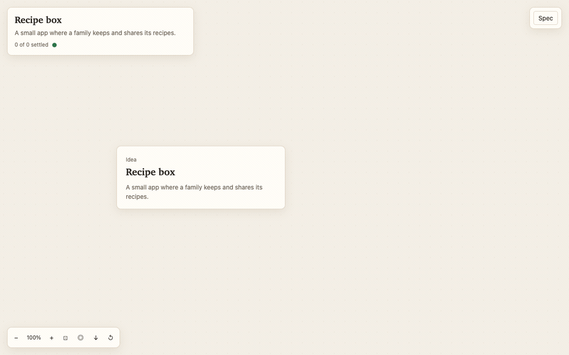
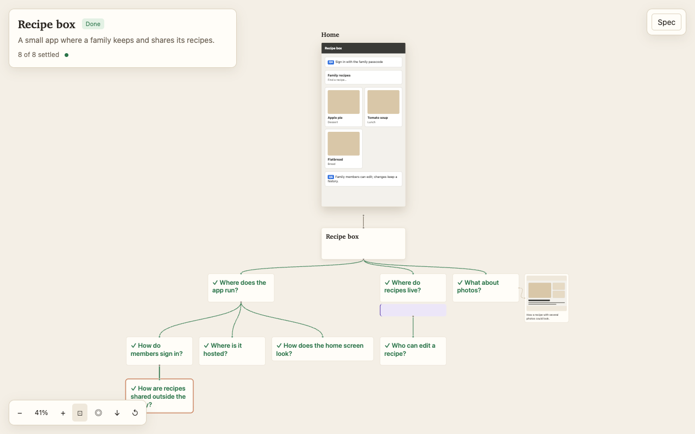

# GrillBoard

**A visual grilling skill for Claude Code and other AI coding agents.** The agent interviews you about your idea, and a live board in your browser turns your answers into a decision tree, sketches and a spec. You answer by clicking, not by typing.

[](LICENSE)




## Why

A good interview before you build saves a rewrite later. But a long question-and-answer thread in a terminal is hard to follow: you lose track of what is decided, what depends on what, and what the thing will look like.

GrillBoard keeps the interview method of Matt Pocock's [grilling skill](https://github.com/mattpocock/skills) and puts the whole interview on one board you can see:

- **Answer by clicking.** Each round of questions shows its options on the board. Click, press "Send answers", and the next round arrives. "Pick the recommendations" takes the agent's suggestions in one click. Typing in chat still works.
- **See the idea take shape.** A decision tree shows what is settled, what is being asked now and what still waits.
- **Choose by looking.** For look-and-layout questions the agent draws a small live sketch for each option.
- **Never lose a new question.** New questions arrive in place, without a page reload, and stay marked until you touch them.
- **Bring your own material.** Paste or drop pictures and links onto the board as references for the next round.
- **Research on the board.** Research notes show their progress live and end in a report you can open.
- **Leave with a spec.** A spec panel collects the decisions, architecture, research and open questions. At the end the agent writes `spec.md`.



## Requirements

- An agent that loads `SKILL.md` skills. Developed and tried with Claude Code.
- Python 3 for the board server. It uses only the standard library.
- A browser.

Without Python, the skill instructs the agent to open the copied `index.html` directly from disk: the board still updates from the session files, but answering on the board and adding references are off. The board and recording have been tried on macOS. Windows has not been tried yet.

## Install

With Node.js installed, one command installs the skill into the current project and asks which agents to set it up for:

```sh
npx skills add Srcanesen/grillboard
```

Add `-g` to install it for every project. This uses the open [`skills`](https://github.com/vercel-labs/skills) installer.

### Manual install

Clone the repository:

```sh
git clone https://github.com/Srcanesen/grillboard.git
cd grillboard
```

Then copy the skill for every Claude Code project:

```sh
mkdir -p ~/.claude/skills
cp -R skills/grillboard ~/.claude/skills/
```

Or symlink it, so that a `git pull` in this checkout updates the skill:

```sh
mkdir -p ~/.claude/skills
ln -s "$PWD/skills/grillboard" ~/.claude/skills/grillboard
```

For just one project, run either alternative from that project's root, replacing the source path with this checkout's absolute path:

```sh
mkdir -p .claude/skills
cp -R /absolute/path/to/grillboard/skills/grillboard .claude/skills/
```

```sh
mkdir -p .claude/skills
ln -s /absolute/path/to/grillboard/skills/grillboard .claude/skills/grillboard
```

Choose one installation method per destination. Symlink commands expect that destination not to exist yet.

## Use

1. In your agent, type: `use grillboard to grill me about a small app where my family keeps and shares recipes`.
2. The agent creates `.grill/<topic>/`, copies the board there, writes the idea and starts the local server. It opens or gives you the board URL.
3. Answer on the board by clicking options and pressing "Send answers", or type your answers in chat. The board shows your settled decisions and the next round.
4. Look at the sketches and research as they appear. Paste or drop pictures and links onto the board to inform the next round.
5. When every branch is settled, confirm the shared understanding. The agent waits for research to finish and writes `spec.md` in the session folder.

## Try the demo board without an agent

Run these commands from the checkout root in a macOS terminal. They work on a temporary copy and leave `examples/demo` untouched:

```sh
demo_dir="$(mktemp -d "${TMPDIR:-/tmp}/grillboard.XXXXXX")"
cp -R examples/demo/. "$demo_dir/"
cp skills/grillboard/viewer.html "$demo_dir/index.html"
board_url="$(python3 skills/grillboard/server.py "$demo_dir")"
open "$board_url"
printf 'Board: %s\nSession copy: %s\n' "$board_url" "$demo_dir"
```

The server chooses an available port and runs in the background. The sample shows the Recipe box tree with some questions and research still open. You can click Q8's three live variants and the send bar; without an agent to take the answers, sent cards stay "Sent". When you finish, stop that server and delete the copy in the same terminal:

```sh
python3 - "$demo_dir" <<'PY'
import json, os, pathlib, signal, sys
state = pathlib.Path(sys.argv[1]) / "server.json"
if state.exists():
    try:
        os.kill(json.loads(state.read_text())["pid"], signal.SIGTERM)
    except ProcessLookupError:
        pass
PY
rm -rf -- "$demo_dir"
```

## How it works

The agent and the board talk through plain files. The agent copies `viewer.html` into a session folder as `index.html`. `server.py` serves that folder locally, and the board reads the session data about once a second and updates in place.

| Session file | Written by | Purpose |
| --- | --- | --- |
| `session.js` | Agent | Idea, questions, decisions, architecture and metadata for sketches, references and research. |
| `user.js` | Server, on board actions | References the user adds, their targets and notes, and sent answer batches; the agent reads it. |
| `refs/` | Agent and server | Agent reference pictures and images pasted or dropped by the user. |
| `sketch/` | Agent | Self-contained HTML sketches, updated as decisions settle. |
| `research/` | Research agent, or the interviewing agent | Live `.log` steps and Markdown reports. |
| `spec.md` | Agent | The confirmed spec, written at the end. |

The agent runs `server.py <session> --wait-answers` in the background to wait for a new answer batch in `user.js`; its JSON output wakes the agent where background commands support that. The agent applies the answers, settles those questions and sets `answered` in `session.js` to the batch id.

The board is one self-contained HTML file with no build step, and the server is one Python file with no packages to install. [`docs/adr/`](docs/adr/) records why.

## Privacy

The server listens only on `127.0.0.1` and uses no third-party packages. It serves files from the session folder and saves pasted or dropped images, reference metadata and sent answer batches there. Link references are stored as URLs; the server does not fetch their destinations. Its server-reuse check contacts its own loopback URL.

The board can load remote reference images and open external links supplied in the session. Research and the agent itself may contact outside services. Their behavior depends on the agent and tools you use.

## Development

Run the tests with `node --test tests/board/*.test.mjs` and `python3 -m unittest discover -s tests/server`. Neither needs a package installed: the board tests load the pure script blocks of `viewer.html` (`grill-session`, `grill-camera`, `grill-layout` and `grill-changes`) in Node, and the server tests start `server.py` in a temporary folder. `GLOSSARY.md` defines the project's words and `docs/adr/` records the decisions behind its shape.

Run `python3 tools/record_demo.py` to rebuild `docs/demo.gif` and `docs/board.png`; it needs Python Playwright, installed Google Chrome and ffmpeg on `PATH`. Edit the `STAGES` list to change the replay; it uses a temporary sample copy and illustrative closing answers, then stops its server and removes the copy.

## Credits and license

The interview method in `SKILL.md` is adapted from Matt Pocock's [grilling skill](https://github.com/mattpocock/skills), licensed under MIT, Copyright (c) 2026 Matt Pocock. The board, server, and the work on sketches, references and research are by [Sercan Esen](https://github.com/Srcanesen), Copyright (c) 2026 Sercan Esen.

This project is licensed under [MIT](LICENSE).
